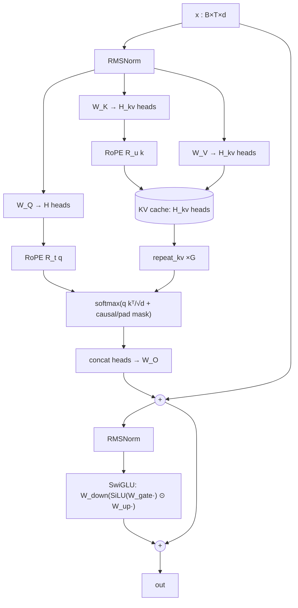
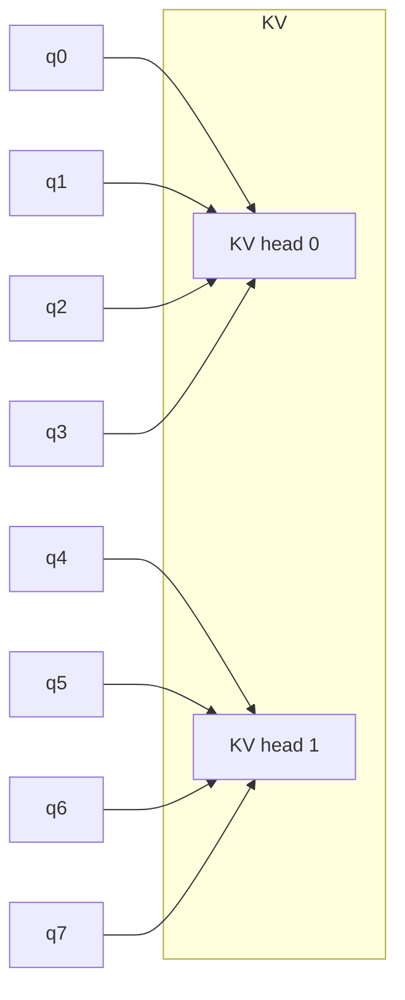

# Architecture

All diagrams are **conceptual**. Which mechanisms are experimentally supported on Cora is stated in `results/summary.md` and `docs/research_report.md`.

## LLaMA decoder block (`src/llama/decoder.py`)



## GQA head sharing (H = 8, H_kv = 2, G = 4)



## Graph block (`src/graph/graph_block.py`, `grouped_attention.py`)

```mermaid
flowchart TB
  H[h : N×d] --> N1[RMSNorm]
  N1 --> Q[W_Q: N×H×d_h] & K[W_K: N×H_kv×d_h] & V[W_V: N×H_kv×d_h]
  PH["node phases φ (per KV head)\nLapPE·ν  |  MLP(RWSE)"] -.-> RQ & RK
  Q --> RQ[R(φ_i) q_i]
  K --> RK[R(φ_j) k_j]
  RQ --> G1["gather q[dst] : E×H×d_h"]
  RK --> G2["gather k[src] : E×H_kv×d_h"]
  EP["edge phases ω·a_ji (antisymmetric)"] -.-> G2
  G1 --> SC["s_ij = qᵀk/√d_h + b_ij"]
  G2 --> SC
  SC --> SM["segment softmax over N(i)"]
  V --> G3["gather v[src] : E×H_kv×d_h"]
  SM --> MSG["α_ij v_j  → scatter-add to i"]
  G3 --> MSG
  MSG --> O[concat → W_O] --> R1((+))
  H --> R1
  R1 --> N2[RMSNorm] --> FF[SwiGLU] --> R2((+))
  R1 --> R2
```

## Differences from the LM block

1. **Attention pattern.** Sparse neighbourhood softmax (`segment_softmax`) instead of a causal dense mask. No causal mask is used.
2. **Positions.** Graph phases (or none) instead of token indices. Index-RoPE exists only as a negative control.
3. **Phase granularity.** Phases are per KV head, shared by the G query heads (math Prop. 3).
4. **Regularisation.** Dropout on inputs, residual branches and attention, which Cora's 140 labels require.
5. **Statelessness.** There is no KV cache, because there is no autoregressive decoding.

## Prediction heads (`src/graph/model.py`)

- **Node classification:** final norm → linear head. Loss: cross-entropy on the training mask.
- **Graph classification / regression:** mean-pool over the `batch` vector → linear head. Loss: CE or MSE.
- **Link prediction:** node embeddings scored by a dot-product decoder, trained with BCE against negatives. Message passing uses training edges only.
